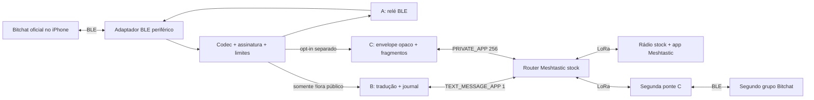

# Arquitetura e decisões

## Caminhos de dados

Um fork basta para B. O T1000-E permanece stock nessa primeira bancada. Dois terminadores
modificados são necessários para C. Intermediário stock não termina o túnel. Nenhum caminho
usa Wi-Fi, MQTT, Nostr, servidor ou telefone dedicado. As funções stock herdadas não são
dependências da ponte. A função A não transmite LoRa; o rádio ainda pode transmitir tráfego
stock se o operador não o desativar no controle negativo.

## Mapa de código

| Arquivo                          | Responsabilidade                                                                |
| -------------------------------- | ------------------------------------------------------------------------------- |
| `BridgeCodec.*`                  | Framing v1/v2, tamanho, UTF-8, assinatura canônica, TTL e TLVs                  |
| `BridgeCrypto.h`                 | SHA-256, HMAC e Ed25519 da biblioteca upstream; validação estrita de entradas   |
| `BridgeState.*`                  | Filas fixas, limites por origem, TOFU volátil, dedup e remontagem BLE           |
| `BridgeBle.*`                    | GATT, anúncios, callbacks curtos, filas por conexão e notificações conforme MTU |
| `BridgeText.*`                   | Prefixos explícitos, atribuição, marcador autenticado e prova de outra ponte    |
| `BridgeTunnel.*`                 | Envelope versionado, MAC, fragmentação e remontagem limitada                    |
| `BitchatBridgeModule.*`          | MeshModule/Router, perfis, NVS, relógio e contadores                            |
| `BridgeMenu.cpp`                 | Controles locais e avisos antes da exportação                                   |
| `BridgeDefaults.h`               | Nome e chave pública do canal dedicado de interoperabilidade                    |
| `variants/bridge/platformio.ini` | Dois alvos separados; ambientes stock não habilitam a função                    |

`TextMessageModule` continua recebendo texto normal. Não há campos protobuf customizados
que os apps originais precisariam reconhecer. B usa a porta nativa 1; C usa a porta privada
256 de laboratório. Coordenar essa porta antes de uma distribuição com outras aplicações.

## BLE e iOS

Serviço release: `F47B5E2D-4A9E-4C5A-9B3F-8E1D2C3A4B5C`.
Característica: `A1B2C3D4-E5F6-4A5B-8C9D-0E1F2A3B4C5D`, READ/WRITE/WRITE_NR/NOTIFY.
Não é o UUID testnet. O rádio implementa o papel **periférico**, sem busca como central.
Isso limita background e ligação entre repetidores sem telefone intermediário.

O anúncio principal contém flags e UUID Bitchat; o nome fica em SCAN_RSP. A administração
anuncia o UUID Meshtastic por cinco minutos. Não presume dois UUIDs de 128 bits no anúncio
legado. Serviços simultâneos não comprovam descoberta/operação simultânea dos apps.
O código separa a desconexão Bitchat da sessão nativa de outro identificador de conexão.
Sem hora confiável, o anúncio Meshtastic é selecionado automaticamente; ao receber hora
do telefone/GPS/RTC, volta a Bitchat. Não se usa hora recebida de peers como autoridade.
O [padrão de instalação](DEFAULTS.md) habilita BLE/texto dedicado uma vez, preservando
escolhas posteriores e canais existentes. Não depende de display, mas exige pareamento.

Configuração: até três links, incluindo a eventual conexão nativa. Quantidade utilizável,
MTU, justiça e reconexão não foram medidos. Há duas posições de recepção e duas de envio
por conexão, com oito frames globais alocados sob demanda e payload de broadcast compartilhado.
O núcleo é alocado em blocos separados; remontagens só consomem memória quando usadas.
A reserva interna de 24 KiB e o bloco livre mínimo de 8 KiB continuam obrigatórios.
Uma conexão lenta expira sua própria fila após dez segundos e é desconectada
para reiniciar o enquadramento; isso não confirma entrega ao usuário.

Intervalos iniciais: 152,5 ms fixo e 1022,5 ms econômico, valores listados pela Apple.
Não são resultados de otimização energética. Janela renovável por botão e anúncios rápidos
transitórios ficam para depois da linha de base. A economia atual mantém descoberta disponível.

## Assinaturas e limites

Bitchat 1.8.0 assina a representação com TTL zero, sem assinatura e sem flag RSR, **com padding**.
O texto público transmitido normalmente não tem padding. Rotas, origem, destinatário, timestamp,
tipo e payload permanecem autenticados. O relé altera somente TTL; não reescreve rotas.
Os 19 vetores usam codec oficial/CryptoKit e incluem padding, compressão, v2 e Noise sintético.
Isso não é ensaio de sessão Noise entre aparelhos.

RSR precisa de contexto de sincronização que a ponte não mantém: é rejeitado. `REQUEST_SYNC`
é local ao link e não é propagado. Não há histórico ou correio durável nem chaves privadas
de clientes. O rádio tem identidade própria para assinar conversões, mas não implementa
caixa de entrada DM: enviar DM **à identidade da ponte** não é suportado.

| Recurso                    | Limite inicial                                                             |
| -------------------------- | -------------------------------------------------------------------------- |
| Frame BLE remontado        | 2048 bytes; payload e tamanho expandido declarado até 1792                 |
| Identidades em RAM         | 24; não expulsa identidade para admitir inundação                          |
| Remontagem BLE             | 3 mensagens, até 32 fragmentos, 30 s sem renovação                         |
| Dedup volátil              | 256 hashes SHA-256, 125 s; cheio rejeita entradas novas                    |
| Texto `!lora`              | 120 bytes UTF-8 depois do prefixo; nunca truncado                          |
| Texto Meshtastic importado | Até 218 bytes, incluindo depois a atribuição em 233 bytes                  |
| Journal persistente        | 64 IDs de 128 bits e timestamps, 10 min; sem payload ou PSK                |
| Fila LoRa                  | 4 pacotes, prazo de 45 s; descarte contado                                 |
| C embarcado                | Frame até 512 bytes; codec testável até 2048                               |
| Remontagem C               | 3 mensagens; 45 s; fragmento útil até 160 bytes                            |
| Orçamento adicional        | Reposição de 5% do tempo no fixo ou 1% no econômico, rajada máxima de 12 s |

O orçamento usa a estimativa do RadioInterface para o pacote completo. Controles regionais,
ocupação e fila stock continuam valendo. Airtime dos intermediários deve ser medido à parte.
Há limite adicional por origem. TX no visor conta submissões ao Router, não ACK no iPhone.

## Eco, reinício e sobreposição

B só exporta `!lora ` público com assinatura válida contra a chave anunciada e canal secundário
selecionado. Nome não autentica ninguém. O texto leva `[BC peerID]` e marcador `mb1` com ID
de conteúdo e HMAC derivado da PSK por HKDF. O sentido contrário leva `[MT !nodeID]`, sob
a identidade da ponte. Isso é atribuição entre redes, não verificação Noise/PKI do remetente.

O marcador reconhece o mesmo evento mesmo se outro gateway criar outro ID Meshtastic.
O journal é gravado antes da exportação; falha de gravação bloqueia a ponte. Evitar repetição
pode perder uma entrega se a energia cair entre journal e transmissão. Não há fila persistida
de payload. Colisões de IDs de 128 bits são tratadas como duplicação; não são matematicamente
impossíveis. A dedup ao importar C também protege mensagens recentes após reinício.

Só um exportador B por malha BLE sobreposta é aceito. Prova em TLV do anúncio, assinada e
autenticada pela chave de canal, permite detectar outra ponte e bloquear B. Há 30 s de
observação ao ativar. **Isso não é consenso distribuído:** perda de anúncio, partição ou
gateways escondidos ainda podem produzir duplicatas stock. A configuração sobreposta
permanece não aceita até ensaio. A contenção não confia em apelidos nem só em prefixos.

C leva versão, domínio de canal, origem, boot, sequência, hash do frame, índice, quantidade,
tamanho e TTL de túnel 1, com HMAC. Recebido de LoRa não é reexportado por LoRa. TTL Bitchat
é consumido pelos relés sem invalidar assinatura. B e C usam canais diferentes e prefixos
exclusivos. Perda leva a expiração/contagem; **não há ARQ próprio**. O cliente mantém seus
limites de repetição; a ponte não inventa ACK de aplicação.

## Hipóteses refutáveis

| Hipótese                        | Evidência atual                                     | Experimento que a refuta                                                             |
| ------------------------------- | --------------------------------------------------- | ------------------------------------------------------------------------------------ |
| A liga dois iPhones             | Codec e caminho compilados                          | Não entregam com ponte ligada, fora do alcance direto, LoRa/internet desligados      |
| B usa um fork e um stock        | Porta 1 e caminho nativo                            | Texto não aparece em algum sentido nas condições do baseline                         |
| C passa por intermediário stock | Porta privada normal                                | Funciona direto, mas falha ao inserir stock com a mesma configuração                 |
| Dois apps coexistem             | Serviços e conexões separados                       | Descoberta, autorização ou desconexão interfere no outro; usar alternância           |
| Retorno automático após energia | Preferências persistidas, relógio ausente no Heltec | Boot sem hora bloqueia: recuperação totalmente automática ainda não atendida         |
| C permite DMs                   | Bytes Noise podem ser opacos                        | Handshake expira, rota falha ou cliente exige estado ausente; não enfraquecer sessão |
| Economia poupa bateria          | Intervalos/orçamento menores                        | Energia por mensagem não melhora ou disponibilidade cai abaixo da necessidade        |

Em LongFast (SF11/BW250/CR4/5, preâmbulo 16), estimativas brutas: 0,72 s/64 bytes,
1,13 s/120, 1,75 s/200, 2,03 s/240. São cálculos, não medidas. Um KiB fragmentado já
exige vários pacotes e dezenas de segundos com contenção/hops. Voz ao vivo de cerca de
16 kbit/s excede a taxa bruta aproximada de 1,07 kbit/s desse preset. Voz contínua, arquivos
e histórico não são funções LoRa aceitas. Noise opaco pode conter mídia, indistinguível sem
descriptografar: a opção privada C é somente opt-in de laboratório com limites rígidos.
